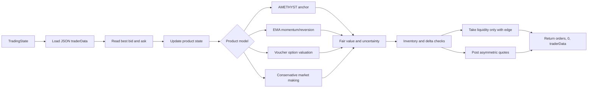
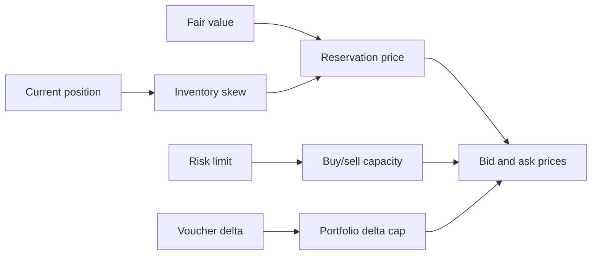
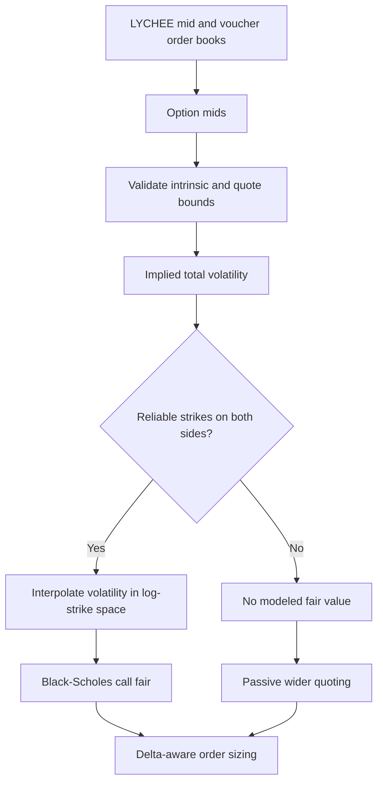

# Team 23 Abstract Content Guide

Use this as the source document for the final QuantiFi abstract. Keep the
submitted PDF concise: one strong page is better than five pages of text.

> **Important correction:** Do not use the attached `$1.3B`, `780K trades`, or
> `17/17 products` claims. They do not match the verified v5 backtest log.

## Required submission details

- **Title:** Adaptive Multi-Product Market Making
- **Team:** Team 23
- **Team members:** `[Insert every team member's name]`
- **Submission:** One abstract PDF and one Python trader file
- **Page limit:** Maximum five pages
- **Recommended length:** One to two pages with diagrams

## Verified performance to report

The verified v5 activity log contains 780,000 market snapshots across three
historical days. It records 18,096 fills involving the submission.

| Metric | Verified value |
|---|---:|
| Day -2 incremental PnL | 29,798.5 |
| Day -1 incremental PnL | 31,648.0 |
| Day 0 incremental PnL | 27,342.0 |
| **Cumulative v5 PnL** | **88,788.5** |
| Submission fills | 18,096 |

### Product attribution

| Product | Cumulative PnL |
|---|---:|
| PAPER_LANTERNS | +25,184.5 |
| TOFFEE_CAKE | +20,913.0 |
| VOUCHER_7500 | +5,912.0 |
| VOUCHER_7600 | +5,845.0 |
| TELLURIUM | +5,492.0 |
| VOUCHER_7400 | +5,481.0 |
| VOUCHER_7300 | +5,081.0 |
| VOUCHER_7000 | +4,406.0 |
| VOUCHER_7750 | +3,066.0 |
| VOUCHER_7900 | +2,149.5 |
| VOUCHER_7200 | +1,780.0 |
| WHITE_PEARLS | +1,748.5 |
| GOLDEN_PEARLS | +1,675.0 |
| AMETHYST | +975.5 |
| DRAGONFRUIT | +915.5 |
| PINK_PEARLS | +530.5 |
| BLUE_PEARLS | +166.0 |
| VOUCHER_6800 | 0.0 |
| VOUCHER_8100 | 0.0 |
| BLACK_PEARLS | 0.0 |
| JELLY | 0.0 |
| PEANUT_BUTTER | 0.0 |
| GRANADILLA | -245.5 |
| FRUIT_BASKET | -370.0 |
| MANGOSTEEN | -553.0 |
| LYCHEE | -1,364.0 |

Backtest 5 improved over backtest 3:

- v3: **87,307.5**
- v5: **88,788.5**
- Improvement: **+1,481.0**, with higher PnL on all three days
- `VOUCHER_8100` improved from **-1,472.0** to **0.0**
- `FRUIT_BASKET` returned to **-370.0** after the failed v4 basket signal

Describe these as historical/in-sample results. The competition score is based
on unseen OOS runs, so do not call the result guaranteed, live, or risk-free.

## Ready-to-use abstract

### Adaptive Multi-Product Market Making

We developed an inventory-aware market-making system for a multi-product
electronic market. The strategy combines product-specific fair-value models
with selective liquidity taking and asymmetric passive quoting. It covers the
named products in the competition universe and all ten LYCHEE voucher strikes,
while applying published position limits and softer internal risk targets.

The algorithm assigns different models to different market structures.
AMETHYST uses the historically stable fundamental anchor of 10,000.
PAPER_LANTERNS uses a bounded EMA momentum signal, while TOFFEE_CAKE uses
EMA-based mean reversion. The remaining ordinary products use conservative
adaptive fair values, order-book imbalance, and inventory-aware market making
rather than an unsupported one-size-fits-all forecast.

LYCHEE vouchers are treated as calls on the LYCHEE underlying. The trader
computes option mids, filters invalid quotes, estimates implied total
volatility through bounded numerical inversion, and interpolates volatility
only between reliable lower and upper strikes. The 6,800 and 8,100 wings are
kept in the universe for breadth but are passive-only and wider quoted because
their historical model confidence is lower. Combined LYCHEE and voucher delta
is capped to control portfolio-level underlying exposure.

Execution is governed by inventory skew, product-specific risk limits, spread
buffers, and position-aware order sizing. The trader persists EMA state and
counts through JSON `traderData`, which is necessary because the competition
runtime may not preserve ordinary Python variables between ticks. At each
tick,
the system updates its state, estimates fair value, checks capacity and
delta exposure, then returns valid orders without exceeding the published
limits.

In the verified v5 historical backtest, the strategy produced cumulative PnL
of **88,788.5**, with positive incremental PnL on all three supplied days.
The two strongest contributors were PAPER_LANTERNS (+25,184.5) and TOFFEE_CAKE
(+20,913.0). The result is presented as historical evidence rather than a
claim of guaranteed OOS performance; the final competition evaluation will be
performed on unseen data.

## Rubric cross-reference

### Breadth

Show that the code covers:

- AMETHYST
- PAPER_LANTERNS and TOFFEE_CAKE
- TELLURIUM
- JELLY and PEANUT_BUTTER
- DRAGONFRUIT, GRANADILLA, MANGOSTEEN, and FRUIT_BASKET
- LYCHEE
- WHITE, BLACK, GOLDEN, PINK, and BLUE PEARLS
- Ten voucher strikes: 6800, 7000, 7200, 7300, 7400, 7500, 7600, 7750,
  7900, and 8100

Be precise: this is **16 named products plus 10 voucher contracts**, or 26
tradable symbols when vouchers are counted separately. If the organizers use
“17 products” as an official grouping convention, use their terminology only
after confirming how they count vouchers.

### Depth

Explain the independent mechanisms:

1. Fundamental anchor for AMETHYST.
2. Momentum for PAPER_LANTERNS.
3. Mean reversion for TOFFEE_CAKE.
4. Conservative adaptive market making for uncertain products.
5. Black-Scholes and implied-volatility interpolation for vouchers.
6. Passive-only treatment for unreliable option wings.
7. Inventory skew and soft risk targets.
8. Portfolio delta control across LYCHEE and vouchers.
9. Position limits and JSON state persistence.

### PnL

Report the verified v5 number and daily breakdown. State that the score will
come from OOS data. Do not report the inflated attachment figures.

### Communication

Use one strategy-flow diagram, one product-model table, one risk diagram, and
one PnL chart. Keep prose short and label every chart with “historical” or
“in-sample” where appropriate.

## Recommended visuals

The repository already contains:

- [v3 PnL chart](logs/v3/pnl.png)
- [v3 position chart](logs/v3/position.png)

For the final abstract, create or export a v5 PnL-by-product chart if
available. Do not label the v3 chart as v5 unless it was regenerated from v5.

### Diagram 1: execution flow

### Diagram 2: inventory-aware quoting

### Diagram 3: voucher valuation

## Claims to avoid

- Do not claim `$1.3B` PnL.
- Do not claim `780K trades`; the log contains 780K market snapshots and 18,096
  submission fills.
- Do not claim all products are profitable.
- Do not claim the basket model is active; the failed directional basket model
  was removed.
- Do not claim OOS success before receiving OOS results.
- Do not call the Black-Scholes price exact; it is a model estimate using live
  chain information.
- Do not claim zero risk or guaranteed returns.

## Final submission checklist

- [ ] Team 23 and every team member appear at the top of page one.
- [ ] Abstract is no more than five pages.
- [ ] PnL figures match the verified v5 log.
- [ ] Historical/in-sample labels are visible.
- [ ] Breadth explains all product families.
- [ ] Depth explains why models differ by product.
- [ ] Risk controls are shown mathematically or visually.
- [ ] Diagrams are readable at PDF scale.
- [ ] Final Python file contains `Trader.run()`.
- [ ] Final Python file returns `(orders, 0, traderData)`.
- [ ] Only one Python file and one PDF are submitted.
