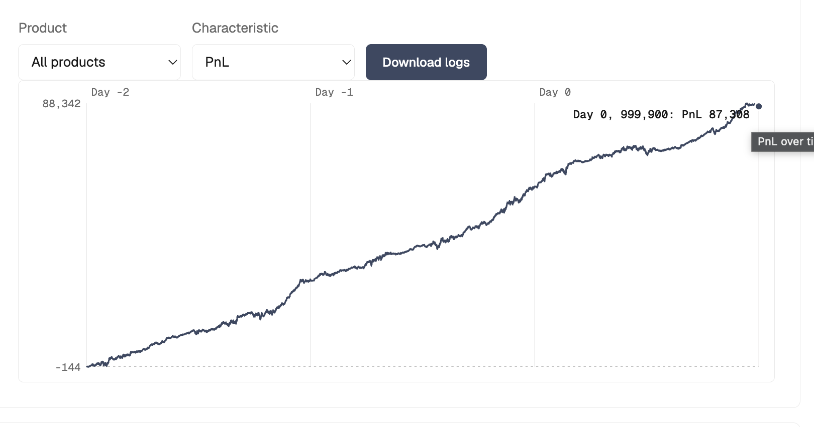
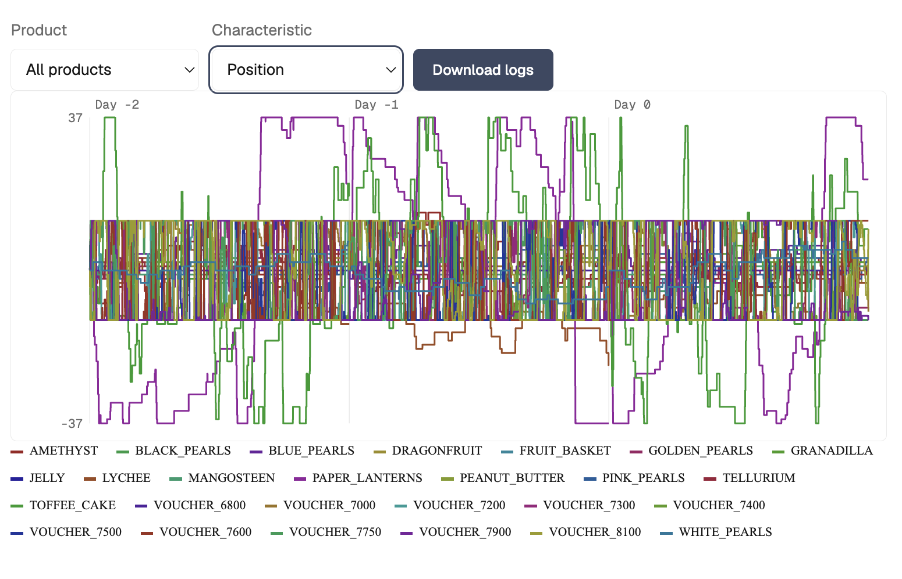

# QuantiFi Competition Team 23

This is a an implmentation of an inventory-aware multi-product trading model that combines fair-value estimation, EMA momentum/reversion signals, option pricing, and relative-value
trading. It takes liquidity only when the estimated edge covers execution risk
and keeps positions within product limits.

- **Core signals:** fixed-value AMETHYST pricing, adaptive EMA signals, and a
  fruit-basket/component relationship.
- **Options:** Black-Scholes voucher pricing with conservative wing handling.
- **Risk:** inventory skew, volatility-aware thresholds, position limits, and
  persistent state between ticks.

## Backtest diagrams

