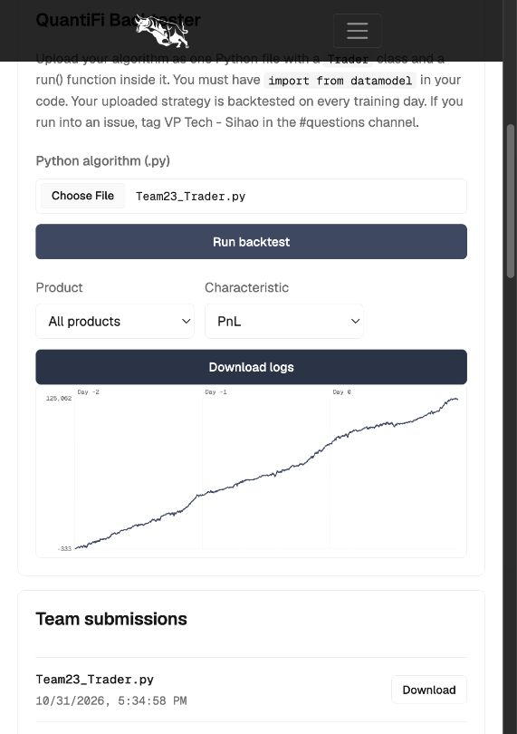
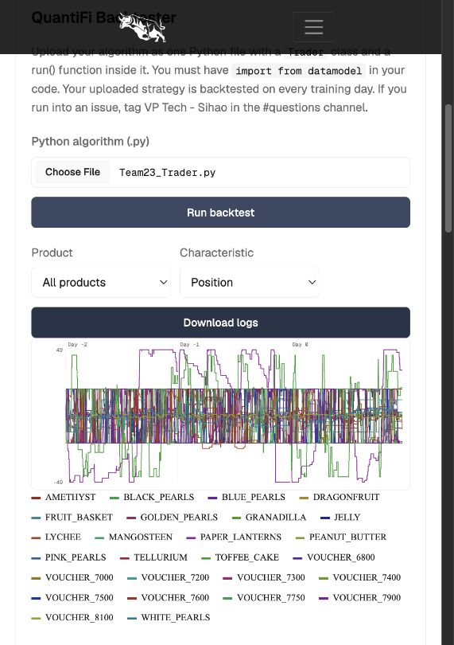

# QuantiFi Competition Team 23

This is an implementation of an inventory-aware multi-product trading model that combines fair-value estimation, EMA momentum/reversion signals, option pricing, and relative-value
trading. It takes liquidity only when the estimated edge covers execution risk
and keeps positions within product limits.

- **Core signals:** fixed-value AMETHYST pricing, EMA momentum/reversion signals and bounded
  trend/imbalance quoting on fruit products.
- **Options:** Black-Scholes voucher pricing with conservative wing handling.
- **Risk:** inventory skew, portfolio-aware underlying hedge quotes, position limits, and
  persistent state between ticks.

The active file is **Team23_Trader.py (V13)**. UTEFA result: **123,640.5 PnL**, **4,128.5 maximum drawdown**, and **26/26 products traded**. This preserves coverage, adds 193.5 historical PnL and reduces drawdown by 292.5 versus V12. The small PnL difference is not proof of improved OOS returns.

See [V13 comparison and rubric review](logs/v13/RESULTS.md), [strategy explanation](STRATEGY.md), and the raw `.log` files in [logs/v13](logs/v13). Local diagnostics live in that folder's `tools` directory; no local backtester is used. Run `python3 logs/v13/tools/summarize_log.py logs/v13/Team23_Trader_V13.log` to reproduce its summary.

## Backtest diagrams

## Further execution experiments

[V14 experiments](logs/v14/RESULTS.md) tested deeper book access, inventory-aware taking and PAPER entry timing through UTEFA. All reduced historical PnL, so the active trader remains V13 unchanged. Sources, rejected runs and raw `.log` files are retained in `logs/v14`.
