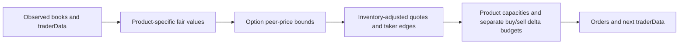

# Team 23: strategy and evidence for the judging rubric

## Breadth: economic reasons for different strategies

| Markets | Live strategy | Important limitation |
|---|---|---|
| AMETHYST | Quote and take around the 10,000 reference value | Reference comes from supplied training prices |
| PAPER_LANTERNS | Continuation of deviation from a slow EMA | Trends can reverse; inventory target 49/50 |
| TOFFEE_CAKE | Reversion toward a slow EMA | A changing fundamental value can defeat reversion |
| TELLURIUM, fruits, basket, LYCHEE | Bounded fast/slow trend plus book imbalance and inventory-aware quotes | No basket-replication trade or active delta hedge is claimed |
| PINK_PEARLS | Small return correction relative to the median of four peer pearls | Correlation is a hypothesis; portfolio neutrality is not enforced |
| Other pearls | Small inventory-aware passive quotes, with bounded trend where enabled | BLACK_PEARLS uses cautious quoting without the trend signal |
| JELLY | Wide-spread, movement-gated passive quoting with at most two units | Entry filters still permit reducing existing inventory; remains loss-making historically |
| PEANUT_BUTTER | Small passive spread capture without a directional signal | Adverse selection remains possible |
| Interior calls | Leave-one-strike-out interpolation of implied total volatility | Needs reliable peer quotes; fallback is book-based market making |
| Wing calls | Tiny passive quotes around the book | No uncertain volatility extrapolation |

All 26 markets had actual fills in V10. This measures participation, not 26 independent or equally complex strategies. The basket and most pearl cross-signals stay disabled after earlier development experiments.

## Depth: valuation, execution and failure handling

The call model infers total volatility v = sigma sqrt(T), avoiding an assumed OOS day counter. It rejects low-vega/infeasible inputs and interpolates between peer strikes in log-moneyness, excluding the contract being priced. V11 additionally bounds the model fair by executable peer quotes using call monotonicity and the maximum one-for-one change in value per strike unit. An inconsistent peer chain disables this model fair; ordinary small book-based quoting remains. These are valuation checks, not atomic arbitrage guarantees. The zero-rate call assumption matches the existing model; no settlement or exercise operation is used.

For peer strike J and target K, the fair-value interval is:

- lower bound: peer bid minus max(K-J, 0);
- upper bound: peer ask plus max(J-K, 0).

Intersect these intervals with intrinsic value and the underlying price. This enforces vertical-spread price relationships without optimizing another historical parameter. It does not establish a fully convex, arbitrage-free volatility surface.

Order sizing accounts separately for all potential buys and all potential sells. An unfilled offsetting order provides no risk credit. Product limits and a current estimated portfolio delta budget apply before submission. Delta changes after spot/volatility moves remain a risk. Persistent memory is serialized in traderData, so restarting the Trader object between ticks preserves decisions.

## PnL: report the experiment accurately

V10's official training result is 119,985 cumulative PnL, or 39,995 mean daily increment. Each supplied day was profitable: 41,488 / 40,977.5 / 37,519.5. Maximum observed drawdown was 4,491.5. V8 Growth returned 112,385.5 with a smaller 4,066 drawdown. V10 increased risk as well as return. Detailed candidate attribution and original logs are under logs/v10.

Reusing the same days for development is not OOS validation. Three positive days and 29 positive historical blocks out of 30 cannot prove future profitability. The actual scoring statistic is average PnL across organizers' unseen runs. No official numerical point weights were supplied; an invented grade would be misleading.

## Communication: material for the eventual abstract

Lead with one clear idea: adapt valuation to market structure, then constrain execution risk consistently across products. Use an architecture diagram, a strategy-family table, an option interpolation/bounds figure, and a profit/drawdown comparison. Explain the failed JELLY experiment and the accepted capacity tradeoff. Disclose the dependence between option positions and profit concentration. Avoid claiming basket arbitrage, guaranteed hedging, or validated OOS profitability.

The final abstract must include **Team 23 and all team members' names at the top of page one**, remain within five pages, and describe the final tested code. Team names have not yet been supplied. A concise explanation with useful figures is stronger than padding to the page limit. The current older abstract is not synchronized with V10/V11 and should not be submitted unchanged.
