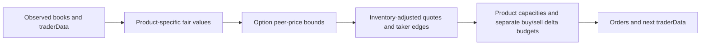

# Team 23: strategy and evidence for the judging rubric

## Breadth: economic reasons for different strategies

| Markets | Live strategy | Important limitation |
|---|---|---|
| AMETHYST | Quote and take around the 10,000 reference value | Reference comes from supplied training prices |
| PAPER_LANTERNS | Continuation of deviation from a slow EMA | Trends can reverse; inventory target 49/50 |
| TOFFEE_CAKE | Reversion toward a slow EMA | A changing fundamental value can defeat reversion |
| TELLURIUM, fruits, basket | Bounded fast/slow trend plus book imbalance and inventory-aware quotes | No basket-replication trade is claimed |
| LYCHEE | Passive hedge quotes skewed by held underlying plus call delta | Hedge fills are uncertain and its 24-unit inventory target can bind |
| PINK_PEARLS | Small return correction relative to the median of four peer pearls | Correlation is a hypothesis; portfolio neutrality is not enforced |
| Other pearls | Small inventory-aware passive quotes, with bounded trend where enabled | BLACK_PEARLS uses cautious quoting without the trend signal |
| JELLY | Wide-spread, movement-gated passive quoting with at most two units | Entry filters still permit reducing existing inventory; remains loss-making historically |
| PEANUT_BUTTER | Small passive spread capture without a directional signal | Adverse selection remains possible |
| Interior calls | Leave-one-strike-out interpolation of implied total volatility | Needs reliable peer quotes; fallback is book-based market making |
| Wing calls | Tiny passive quotes around the book | No uncertain volatility extrapolation |

All 26 markets had actual fills in the selected V13 UTEFA run. This measures participation, not 26 independent or equally complex strategies. The basket and most pearl cross-signals stay disabled after earlier development experiments.

## Depth: valuation, execution and failure handling

The call model infers total volatility v = sigma sqrt(T), avoiding an assumed OOS day counter. It rejects low-vega/infeasible inputs and interpolates between peer strikes in log-moneyness, excluding the contract being priced. V11 additionally bounds the model fair by executable peer quotes using call monotonicity and the maximum one-for-one change in value per strike unit. An inconsistent peer chain disables this model fair; ordinary small book-based quoting remains. These are valuation checks, not atomic arbitrage guarantees. The zero-rate call assumption matches the existing model; no settlement or exercise operation is used.

For peer strike J and target K, the fair-value interval is:

- lower bound: peer bid minus max(K-J, 0);
- upper bound: peer ask plus max(J-K, 0).

Intersect these intervals with intrinsic value and the underlying price. This enforces vertical-spread price relationships without optimizing another historical parameter. It does not establish a fully convex, arbitrage-free volatility surface.

Order sizing accounts separately for all potential buys and all potential sells. An unfilled offsetting order provides no risk credit. Product limits and a current estimated portfolio delta budget apply before submission. Delta changes after spot/volatility moves remain a risk. Persistent memory is serialized in traderData, so restarting the Trader object between ticks preserves decisions.

## V13 portfolio-aware underlying quotes

The earlier bot skewed LYCHEE quotes using only its own inventory. A short underlying position can offset long call delta, so that standalone inventory penalty could work against the option portfolio. V13 instead uses held portfolio delta D = LYCHEE position + sum(call position times model delta) for LYCHEE quote and size skew. Its fair is the current book mid, removing the competing outright trend/imbalance signal.

The underlying reservation-price shift is (D / 35) times max(2, half-spread). Product capacity still uses the actual LYCHEE position and its 24-unit soft limit. Estimated portfolio delta remains capped at 35 for new pending-side exposure. Unfilled opposite orders receive no credit. This is passive hedging: no immediate fill, complete neutrality or future delta bound is guaranteed.

A separately tested convex-option payoff check reduced historical PnL and increased drawdown, so it is archived and excluded. The active model retains the existing vertical-spread bounds. A simple fruit-return lead/lag diagnostic also failed to support adding the proposed basket forecast. These decisions keep unsupported additions out of the active bot.

## V12 execution improvement retained in V13

V12 uses six-unit core orders, with a 49-unit PAPER_LANTERNS inventory target and a 45-unit TOFFEE_CAKE target. The differing budgets reflect the tested execution/risk response of momentum and reversion. Pending buys and sells still reserve separate risk budgets.

On non-core spot products, the reducing side may concede a bounded part of the spread to release inventory. For example, with fair 100, best bid/ask 98/102, and an inventory-adjusted reservation of 98, the old fair-edge floor can hold an ask at 101. The new exit rule permits an ask at 100, capped to the inventory still held after earlier reducing orders. New entries retain their estimated-edge requirement. These passive exits can lose estimated edge; their purpose is lower inventory holding risk.

## PnL: report the experiment accurately

V13's selected UTEFA result is 123,640.5 cumulative PnL, or 41,213.5 mean historical daily increment. Each supplied day was profitable: 44,521.5 / 42,591.5 / 36,527.5. Maximum observed drawdown was 4,128.5. V12 returned 123,447 with 4,421 drawdown. V13's day -1 profit is lower than V12; the other two days improve. V11 returned 119,985 with 4,491.5 drawdown. V12 improves total profit and drawdown, but its day 0 result is lower. V8 Growth returned 112,385.5 with a smaller 4,066 drawdown. V10 increased risk as well as return. Detailed comparisons and raw UTEFA logs are under logs/v13, with earlier experiments preserved in their version folders.

Reusing the same days for development is not OOS validation. Three positive days and 29 positive historical blocks out of 30 cannot prove future profitability. The actual scoring statistic is average PnL across organizers' unseen runs. No official numerical point weights were supplied; an invented grade would be misleading.

## Communication: material for the eventual abstract

Lead with one clear idea: adapt valuation to market structure, then constrain execution risk consistently across products. Use an architecture diagram, a strategy-family table, an option interpolation/bounds figure, and a profit/drawdown comparison. Explain the failed JELLY experiment and the accepted capacity tradeoff. Disclose the dependence between option positions and profit concentration. Avoid claiming basket arbitrage, guaranteed hedge fills, or validated OOS profitability.

The final abstract must include **Team 23 and all team members' names at the top of page one**, remain within five pages, and describe the final tested code. Team names have not yet been supplied. A concise explanation with useful figures is stronger than padding to the page limit. The current older abstract is not synchronized with V13 and should not be submitted unchanged.
